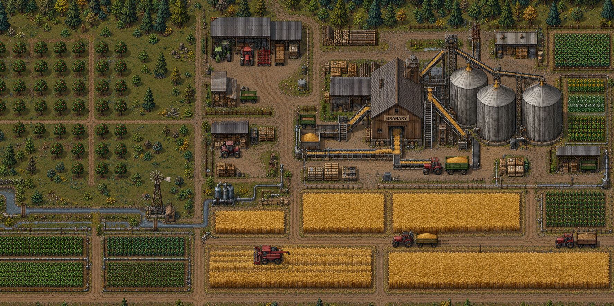

# Granary design

Use this document when changing Granary’s website, illustrations, or motion. The approved visual anchor is the farming simulation below. Existing code is implementation evidence, not blanket design approval.

## Direction and approval status

Granary installs versioned docs and source as local context packs for coding agents. The farm gives it a recognizable identity; the rest of the page must explain that product. Read [product direction](docs/concepts/context-packs.md) before inventing a feature illustration.

| Status   | Decision                                                                                                                                                                      |
| -------- | ----------------------------------------------------------------------------------------------------------------------------------------------------------------------------- |
| Approved | Detailed, grounded, top-down agricultural automation inspired by Factorio.                                                                                                    |
| Approved | The farm fills the hero rather than sitting in a small framed illustration.                                                                                                   |
| Approved | Grain follows the scene’s existing conveyors and elevators. The original combine harvests standing wheat and leaves stubble.                                                  |
| Approved | TypeScript, Rust, and Python have separate choices, generous gaps, and no enclosing panel.                                                                                    |
| Rejected | Generated language crates in `pack-typescript`, `pack-rust`, and `pack-python` PNG/WebP assets. They look like polished inventory collectibles rather than part of this farm. |
| Rejected | Crude flat machinery, detached tractor overlays, and arbitrary driving controls.                                                                                              |
| Approved | Language choices use text and language icons without illustration.                                                                                                            |
| Pending  | Final lower-page composition and approval of the current product diagrams.                                                                                                    |

**Ask before changing the visual direction.** Generate one candidate for review before producing a set or wiring it across the page. A rejected image remains rejected even if it is still referenced by the current CSS.

## Atmosphere and imagery

### Why

The approved hero feels like a working agricultural system. Matching only its subject matter produces unrelated farm-themed art.

### Rules

- MUST use [the approved source image](.github/assets/farm-simulation.png) as the reference for camera angle, pixel density, materials, lighting, and machinery scale.
- MUST preserve its dense field layout, practical equipment, worn materials, and muted earth colors when extending the scene.
- MUST preserve the untouched source and the original nighttime illustration backup, `.github/assets/hero-farm.webp`.
- SHOULD use crisp pixel rendering for farm art. CSS `image-rendering: pixelated` does not turn smooth illustration into matching pixel art.
- MUST NOT introduce fantasy props, cinematic lighting, glossy collectible objects, neon effects, or oversized language logos into the farm.
- MUST NOT copy Factorio artwork or branding. It is a reference for agricultural automation and visual craft.
- SHOULD use precise file trees, manifests, source flows, and review comparisons below the hero. Do not repeat decorative farm crops in every section.

## Color

These values describe the current Granary dark theme in `createGranaryTheme()` in [the site configuration](ciderpress.config.ts). Reuse semantic theme roles instead of adding nearly identical colors. The illustrated scene has its own broader material palette.

| Role              | Value                       | Use                                                    |
| ----------------- | --------------------------- | ------------------------------------------------------ |
| Canvas            | `#0c1010`                   | Page background.                                       |
| Alternate surface | `#101615`                   | Secondary regions and terminal title bars.             |
| Elevated surface  | `#161d1a`                   | Cards and raised controls.                             |
| Recessed surface  | `#080c0c`                   | Code, terminal bodies, gutters.                        |
| Primary text      | `#f7eedc`                   | Headings and important content.                        |
| Secondary text    | `#b9c2b7`                   | Body copy and supporting labels.                       |
| Muted text        | `#8e9b8d`                   | Tertiary metadata; verify contrast at its actual size. |
| Brand             | `#d6a252`                   | Primary actions, links, focus, selected details.       |
| Brand hover       | `#f7e5c5`                   | Hover emphasis.                                        |
| Brand active      | `#b77a2b`                   | Pressed brand controls.                                |
| On-brand text     | `#181610`                   | Text on filled amber controls.                         |
| Sage accent       | `#a6c58b`                   | Supporting icons and syntax strings.                   |
| Border            | `rgba(185, 194, 183, 0.16)` | Component outlines.                                    |
| Divider           | `rgba(185, 194, 183, 0.09)` | Quiet section separation.                              |

Keep amber selective. Large warm-white text areas and dark green-black surfaces should carry most of the interface. Sage is a supporting accent, not a second competing brand. Color alone must not communicate success, conflict, or selection.

## Typography

Use the existing theme aliases; verify computed fonts in the browser before claiming a particular family is active. Bundled font definitions and effective overrides can differ.

| Role                         | Existing hook                  | Treatment                                                                                    |
| ---------------------------- | ------------------------------ | -------------------------------------------------------------------------------------------- |
| Hero display                 | `--cp-font-family-pixel`       | Short, prominent headline; current size is `clamp(44px, 5vw, 70px)` with `1.08` line height. |
| Body and documentation       | Existing sans/body theme roles | Readable paragraphs; do not turn long copy into pixel text.                                  |
| Commands, paths, labels, HUD | `--cp-font-family-mono`        | Precise technical information; avoid long all-caps passages.                                 |

Keep the hero headline near its current 560px maximum width and supporting copy near 460px on desktop. Let text wrap naturally at narrow widths. Do not shrink body text to preserve a desktop composition.

## Layout and components

### Why

The farm can be dense. The interface around it needs space and a clear reading order.

### Rules

- MUST keep the hero scene full-width with readable, left-aligned copy and an unobstructed primary action. Use the dark scrim to separate text from machinery.
- SHOULD reuse the existing content widths: up to 1320px for the hero inner container and roughly 1160–1200px for lower-page content.
- SHOULD build ordinary spacing from 4px increments. Existing language-card gaps are 32px on desktop and 24px below 880px.
- MUST keep language choices in separate dark cards with generous gaps and no shared outer panel. The open-column and linked-row treatments were rejected. Use text and language icons without decorative artwork or empty image placeholders.
- SHOULD use restrained 4–8px corners, thin borders, and limited elevation. Avoid pill-heavy controls, glass panels, and decorative glow.
- MUST provide visible keyboard focus for links and controls, including card links. Hover must not be the only indication of interactivity.
- MUST distinguish interactive controls from decorative HUD readouts. Do not present fake game controls or unsupported product actions.

Primary actions use amber fill with dark text. Secondary actions remain quieter. Preserve existing button states; disabled controls must look unavailable without removing their meaning.

## Product illustrations and page narrative

The final CTA uses centered copy and buttons over one continuous, subdued wheat field, with a strong dark overlay and a soft fade at the top and bottom. The approved artwork is `.github/assets/cta-wheat-field.png`; serve its optimized WebP as a single covering image without tiling, buildings, or machinery. Use normal image interpolation, not forced pixelated scaling. The earlier narrow `farm-wheat.webp` crop is rejected. Do not restore the detached thumbnail.

Illustrations should answer a concrete question: what is installed, where does it live, how does an agent find it, or what changes during an update? Use real terminology and valid examples. Do not imply hosted indexing, autonomous synchronization, or other unimplemented behavior.

Current SVG studies are [installed workspace](.github/assets/context-workspace.svg), [source flow](.github/assets/context-sources.svg), and [reviewed update](.github/assets/context-review.svg). Treat them as implementation studies awaiting visual review, not approved art templates.

Keep the installation diagram’s manifest-to-file-tree composition in the left/right split beside its explanatory copy. The code-only replacement was rejected; a separate full-width row is not the selected layout. Improve readability through larger diagram text and a slightly wider visual column. Stack naturally on narrow screens. Further mobile work must preserve the visual composition instead of replacing it with a shell transcript.

Keep the source-flow visual to the connected diagram only, without an enclosing frame, background panel, visible title, or footer legend. Use the canonical Granary icon in its central node rather than a house symbol; preserve its existing relationships and layout.

The same diagram-only treatment applies to the installation visual: retain the manifest and file-tree nodes, but omit the outer background/grid, title, and footer strip. Keep the individual nodes’ surfaces and labels.

Use the same treatment for reviewed updates: baseline, local, and incoming nodes flow into individual review choices. Omit the terminal banner and footer copy, preserve the three-way comparison, and keep labels concise and larger rather than adding a surrounding panel.

The approved page sequence is:

1. Full farm hero and primary action.
2. Installation diagram, followed by a compact select/install/agent summary and one quick-start button. No workflow tabs or second heading.
3. Source-flow diagram explaining how agents find and read the installed material.
4. Reviewed updates and local customizations.
5. Recommended language packs in the original separate dark cards. The open-column and linked-row replacements were rejected.
6. Final call to action.

The six-card capabilities grid is not rendered. Its content and previous language-card surface settings remain in [.github/assets/landing-layout-archive.json](.github/assets/landing-layout-archive.json) for reuse. Keep all artwork assets until the end-of-work cleanup is explicitly authorized.

Use [Viteval](https://viteval.dev/) as a reference for explaining a developer product through lower-page visuals, not as a palette or brand template. Confirm section order and replacement art with Zac before a new redesign pass.

## Motion

Frame the hero tightly around the barn and fields, reducing the northern scenery and log stacks. Crop the SVG viewport so the raster and animated overlays remain registered. Remove the footer HUD and status text; keep a quiet, transparent pause/resume icon in the bottom-right corner, with a clear hover/focus state and accessible name.

### Why

Movement should make the existing farm operate. Unregistered overlays break the scene’s physical logic.

### Rules

- MUST register animation paths and masks to the approved scene’s coordinate system. Grain stays on existing belts and elevators.
- MUST use the original combine in its actual field. Reveal cut stubble behind the harvester rather than moving a vehicle over already harvested rows.
- MUST keep scenery and machine scale stable through responsive cropping. Do not move overlays independently of their background.
- MUST honor reduced-motion preferences and provide an accessible pause control for continuous animation.
- SHOULD pause decorative work when the hero is out of view or the document is hidden.
- MUST keep essential text, navigation, and product explanations usable without animation or JavaScript.
- SHOULD use transforms and opacity for ordinary transitions. Avoid scroll hijacking, parallax, layout-shifting reveals, and gratuitous bouncing.

The current combine loop is 34 seconds; conveyor loops are about one second. These describe the implementation, not a requirement to add more motion. Review the loop reset for visible jumps.

## Responsive behavior and accessibility

- Preserve the full-hero treatment on mobile while keeping headline, actions, and pause control legible. Crop scenery deliberately; never distort it.
- Stack cards and split sections before text or diagrams become cramped. Current pack cards stack below 880px; hero adjustments begin below 900px.
- Verify at narrow mobile, tablet, and desktop widths. Check horizontal overflow, long commands, focus visibility, and diagram labels.
- Use semantic headings and real links/buttons. Give meaningful illustrations useful alternative text; hide purely decorative animation from assistive technology.
- Keep diagram meaning available as text. Never bake essential instructions exclusively into an image.
- Check WCAG AA contrast (4.5:1 for normal text, 3:1 for large text) and non-text contrast for controls. Palette membership does not prove compliance.
- Provide at least 24px interactive targets, preferably 44px for mobile controls. Expand the hit area rather than enlarging every icon.

These are review requirements, not a claim that the current site passes an accessibility audit.

## Asset handling and implementation map

| File                                                      | Responsibility                                                   |
| --------------------------------------------------------- | ---------------------------------------------------------------- |
| `ciderpress.config.ts`                                    | Theme values, landing content, section composition.              |
| `.github/assets/farm-hero.css`                            | Hero presentation, responsive layout, motion, landing overrides. |
| `docs/components/farm-hero.tsx`                           | Registered scene, machinery overlays, motion controls.           |
| `.github/assets/farm-simulation.png`                      | Approved untouched visual reference.                             |
| `.github/assets/hero-farm.webp`                           | Original nighttime illustration backup.                          |
| `.github/assets/context-*.svg`                            | Current product diagram studies.                                 |
| `.github/assets/pack-{typescript,rust,python}.{png,webp}` | Rejected artwork; do not reuse as the design reference.          |

Keep editable/source assets and optimized delivery assets distinct. Use SVG for diagrams and optimized raster formats for detailed farm art. Preserve aspect ratios and reserve layout space. Review compression at the rendered size so fine pixel details survive.

## Review and enforcement

1. Read this file, inspect the approved hero, and identify whether the task changes an approved choice or a pending decision.
2. For a new visual direction, ask one specific question with numbered choices and a recommendation. Wait for the answer.
3. Show one candidate in page context before generating variants or applying it to a whole section. Explicit approval establishes the new reference.
4. Check desktop/mobile layout, keyboard focus, reduced motion, pause behavior, and an actual animation cycle when relevant.
5. Run `pnpm docs:index` after indexed Markdown changes. Run `pnpm validate` and `pnpm build`; also run `pnpm docs:build` for site changes.

Automated checks cover types, lint, formatting, tests, docs links, and index consistency. They do **not** establish visual fit or user approval. Update the decision table when Zac approves or rejects a direction. Do not silently promote a proposal to an approved rule.

## Research references

- [VoltAgent awesome-design-md](https://github.com/VoltAgent/awesome-design-md): structure for atmosphere, tokens, components, responsive behavior, and agent guardrails. Its extracted analyses are not first-party brand specifications.
- [VoltAgent official-design-md](https://github.com/VoltAgent/official-design-md): collection distinguishing first-party documents from extracted analyses.
- [VoltAgent DESIGN.md](https://github.com/VoltAgent/voltagent/blob/main/DESIGN.md): example of concrete tokens alongside narrative guidance. Granary does not adopt its electric-green branding.
- [Oxide design system](https://github.com/oxidecomputer/design-system/blob/master/design.md): semantic surfaces, text and stroke roles, constrained accents, and technical-interface precision.
- [Vercel Web Interface Guidelines](https://vercel.com/design/guidelines): keyboard behavior, focus, target sizes, reduced motion, and responsive checks.

These inform the document’s structure and review criteria. Granary’s approved artwork and explicit decisions determine its visual identity.
