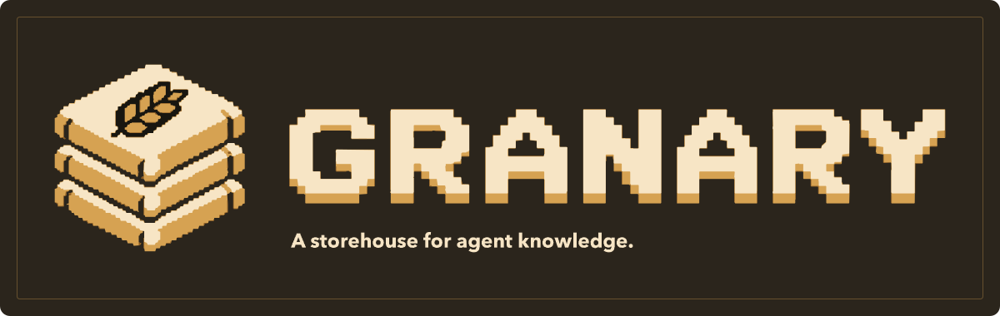

<div align="center">
  
  <p><strong>A storehouse for agent knowledge.</strong></p>
  <p>Install versioned docs, source, and examples where your coding agent can read them.</p>

<a href="docs/getting-started/quick-start.md">Quick start</a> &nbsp;·&nbsp; <a href="docs/reference/cli.md">CLI reference</a> &nbsp;·&nbsp; <a href="contributing/README.md">Contributing</a>
</div>

## Features

- Install reference material from local folders or Git repositories, with or without an upstream manifest.
- Pin source revisions and file hashes in a lockfile. Restore the same content on another machine.
- Link installed entrypoints in `AGENTS.md` without replacing your instructions.
- Review upstream updates before applying them, with protection for local edits.
- Read ordinary files with any coding agent. Installed context is available offline.

## Install

Requires Node.js 26+ and Git. Supports macOS and Linux.

```sh
npm install --global granary-ai
granary --version
```

## Usage

### Add framework docs

Run from your project root:

```sh
granary add nextjs@16
granary list
```

This installs Next.js documentation, not the Next.js dependency. Granary selects a stable release, locks its exact commit, and links the installed docs in `AGENTS.md`.

Commit `granary.json`, `granary-lock.json`, and `AGENTS.md`. Context and cache files under `.granary/` are Git-ignored. Teammates restore the locked selection with:

```sh
granary install
```

### Choose your own sources

Add a local folder with `granary add ./reference`, or select repository files in `granary.json`:

```json
{
  "name": "my-app",
  "packs": {
    "github:vercel/next.js": {
      "tag": "v16.0.0",
      "files": { "include": ["docs/**", "examples/**"] },
      "output": "reference/nextjs"
    }
  }
}
```

Run `granary install` to resolve and lock the selection. Upstream repositories do not need a Granary manifest. See [project configuration](docs/reference/project-config.md) for composition and output paths.

### Review updates

```sh
granary update > review.json
```

Inspect the review and resolve deferred or conflicting decisions before applying it:

```sh
granary update --apply review.json
```

### Use the SDK

```sh
npm install granary-ai
```

```ts
import { granary } from 'granary-ai'

const result = await granary().packs.list()
if (result.ok) console.log(result.value)
```

Importing the SDK does not start the CLI. See the [API reference](docs/reference/core-api.md) for typed outcomes and optional plugins.

## Documentation

- [Quick start](docs/getting-started/quick-start.md)
- [Install packs](docs/guides/install-packs.md) and [create a pack](docs/guides/create-pack.md)
- [CLI reference](docs/reference/cli.md) and [project configuration](docs/reference/project-config.md)
- [Engineering standards packs](packs/README.md) for TypeScript, Rust, and Python

Granary is an early release. Windows, website ingestion, and hosted registries are not implemented. See [VISION.md](VISION.md) for the product direction.

## Development

Use **Node.js 26 or newer** and the pnpm version pinned in `package.json`.

```sh
pnpm install
pnpm build
pnpm cli --help
pnpm validate
pnpm docs:build
```

Read [Contributing](contributing/README.md) for testing, documentation, and release workflows. Run `pnpm docs:dev --headless` to preview the site.

## License

[MIT](LICENSE)
